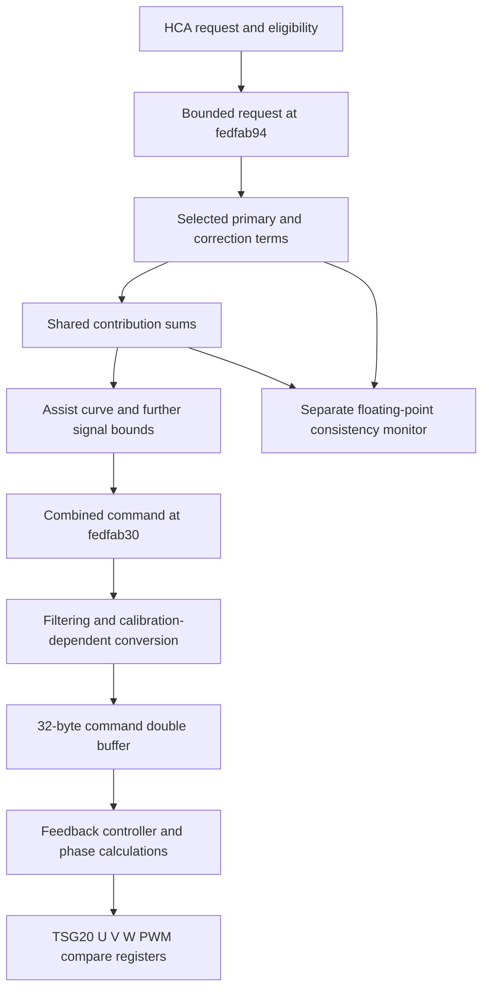

# HCA downstream path in 1061

October 19, 2026. Continuation of [the first torque-threshold investigation](TORQUE_LIMITS_1061.md). Offline static analysis only.

## Result

The HCA-associated request can be followed from its bounded signal into shared assist calculations, a buffered feedback controller, and three phase PWM compare registers. This connects the earlier request threshold to a plausible motor-control path. It does not establish execution on a particular rack, the active calibration, motor current in amperes, or delivered steering torque.

The path branches into two contributions. Treating the request as one number that is simply clipped and sent to the motor would miss the assist calculation and consistency checks.

## Request selection and the two contributions

`0x24aec` requests channel0 through `0x36d64(0)` before setting its active flag. `0x36d64` grants a channel when `0xfedfbf18` is clear and its identifier is at most9. It records the selected identifier at `0xfedfaf5b`. This is observed selection/exclusion logic, not proof of a complete priority policy. `0x36d80` releases the matching channel and resets its contribution fields.

After `0x24694` bounds the request into `0xfedfab94`, function `0x244fe` builds two terms:

| Term | Static operation | Destination |
| --- | --- | --- |
| Primary | Pass the bounded request as the first argument of `0x36e02` | `0xfedfbf1c` |
| Secondary | Multiply by `0x5e62a=2621` with shift15, apply a profile curve, saturate to ±3584, add a sign term, then bound by `0x5e634=511`; add vibration contribution `0xfedfab96` | `0xfedfbf1e` |

The first gain is `2621/32768`, approximately0.079987. The sign-term scalar at `0x5e802` is zero in these bytes. The secondary bound511 is approximately0.4990Nm under the earlier signal scale, **not** a bound on total motor torque. Vibration is added after that bound. `0x24808` constructs the alternating vibration contribution from the previously decoded amplitude and state.

Setter `0x36e02` updates its fields only if its sixth argument equals the selected channel. Here the HCA caller uses0. It also sets a third contribution and two scale fields. Other channels and the separate additive contributor group can still matter.

## Shared sums and assist calculation

Function `0x36fd4` collects six other contribution slots into `0xfedfbf26/28/2a` and computes minimum scale values. Their functional identities are not assigned from slot numbers alone.

Function `0x36c46` combines the selected and additive terms:

| Shared signal | Observed equation | Next relevant consumer |
| --- | --- | --- |
| `0xfedfaafc` | `0xfedfbf26 + 0xfedfbf1c` | `0x258b0` |
| `0xfedfaaf8` | `0xfedfbf28 + 0xfedfbf1e` | `0x2143e` |
| `0xfedfacd8` | `0xfedfbf2a + 0xfedfbf20` | Consistency and other control paths |

Several stores use duplicate RAM values and call `0x3925a` on mismatch. These checks are not themselves torque-limit tables.

The primary shared term enters `0x258b0` at `0x25994`. That function forms `0xfedfab48` from `0xfedfaafc`, `0xfedfabbc`, and a scaled/clamped `0xfedfab32`. It uses the magnitude to locate/interpolate RAM curve data, applies profile/scale factors, then bounds the result by flash `0x5e5d8=4813` before storing `0xfedfab4a` at `0x25be6`. The signal bound corresponds to approximately4.7002 in the earlier Nm-like scale; it is not a demonstrated physical output ceiling. Function `0x255dc` further processes this into `0xfedfab3e`.

Function `0x2143e` includes `0xfedfab3e` and secondary shared term `0xfedfaaf8` in a larger sum, applies saturation/conditional scaling, and stores `0xfedfab30` at `0x21846`. Thus the primary and secondary HCA contributions reach the combined command by different routes. Other summed terms, profile selection and feedback are material to the result.

## Separate consistency-monitor branch

The same caller `0x244fe` sends float-scaled copies to `0x37b3a`. Its fields are read by `0x373d2`, which compares the float-side selected-plus-additive sums with fixed-point aggregate signals. For example:

- `0xfedfbf44` is written at `0x37b4e` and read at `0x373e2` for comparison with `0xfedfaafc/1024`.
- `0xfedfbf3c` is written at `0x37b5a` and read at `0x3741c` for comparison with `0xfedfaaf8/1024`.
- `0xfedfbf48` is written at `0x37b52` and read at `0x37456` for comparison with the third aggregate.

It builds a discrepancy result at `0xfedfadf0` and calls the reporting helper with identifier `0x3eda`. The observed float tolerances include0.1 and5.0. These are comparison tolerances in this code, not newly discovered torque ceilings. The float reconstruction has compiler/decompiler artifacts, so formulas are corroborated with direct references rather than treated as original source.

## Combined command to phase PWM

| Stage | Functions and signals | Observation |
| --- | --- | --- |
| Command processing | `0x3671a`: `fab30 -> fac04`; `0x361e4`: `fac04 -> fabfc`; `0x3660a`: `fabfc + fabfa -> fabfe` | State-dependent filtering, scaling, limiting and an additional correction |
| Validity gate | `0x4a494`: `fabfe -> fab2a` | Values outside signed[-8192,8192] become zero; accepted signed value and absolute value are stored separately |
| Controller input preparation | `0x463e2`: `fab2a -> fedf9f68 -> buffer slot2` | Calibration-dependent clamp, multiplication and shifts; physical units unresolved |
| Buffer handoff | `0x4636e`, `0x46380`, `0x46390` | Two32-byte buffers at `0xfedfc2ac` and `0xfedfc2cc`; producer and consumer slot2 both mean byte offset4 |
| Feedback controller | `0x1da5a` | Reads slot2, subtracts transformed feedback, integrates error with a gain from slot12, and computes phase quantities |
| Output preparation | `0x18e72` | Converts six unsigned values using `(value*50+512)>>10`, storing `0xfedfaa54..0xfedfaa5e` |
| Output selection | `0x18ed6` | Selects three of these values or another state-dependent output and calls `0x3ebbc` for channels0/1/2 |
| Hardware writes | `0x3ebbc` | Caps unsigned input at2500 and writes `2500-value` to `0xffffccb0`, `0xffffccb4`, `0xffffccb8` |

Short RAM names in this table retain the `0xfedf` prefix, for example `fab30` means `0xfedfab30`.

The applicable manufacturer manual independently identifies those hardware addresses. Table15-2, printed page887/PDF page907, gives TSG20 short base `0xffffcc00`. Table15-6, printed page892/PDF page912, gives offsets `0xb0/0xb4/0xb8` as **HT-PWM U/V/W phase compare registers**. Therefore2500 is a timer-domain cap here, not2500Nm or2500A. Manual identity/provenance: [MCU_IDENTIFICATION.md](MCU_IDENTIFICATION.md), SHA-256 `f2914aa669635072756bc530485d8bc690dede0e8398b51ee6adcc3b62b3bd22`.

The feedback, integrator, phase calculations and matching peripheral registers support the motor-control interpretation. Static control/data flow does not establish that every branch runs in the user's physical variant.

## Evidence and remaining boundary

Artifact identity remains mapped SHA-256 `a785ba137aa8b6e8a5d0d54cbb3f26108a273f23acdf6ca4f808b1e46186ff9d`, loaded at `0x2000`, with H1 SHA-256 `75fd1641e3826e71bdc09a45a0e1581f0e43b01352e23c441b87f01f7d965641` loaded at `0xf000`. Address offsets are relative to this mapping, not an arbitrary raw-file load.

- [Selected downstream assembly and pseudocode](../evidence/ghidra-hca-downstream-1061-2026-10-19.txt).
- [Command processing, controller and output assembly/pseudocode](../evidence/ghidra-hca-motor-chain-1061-2026-10-19.txt).
- [Structured motor-chain evidence, exact references and buffer checks](../evidence/hca-motor-chain-1061-2026-10-19.json).
- [Validation and artifact hashes](../evidence/hca-downstream-validation-1061-2026-10-19.json).

The saved refined project was read-only, with no reanalysis. Exports are direct Ghidra12.1.4 observations under the REA skill's documented V850 fallback, not REA Evidence IDs. The two large controller decompilations contain merged-register and overlapping-global warnings; the complete value flow has not been hand-proved instruction by instruction.

The crucial unresolved boundary is **active calibration and physical conversion**. Fields referenced by `0x463e2`, including `0x603f8` and `0x604d8`, contain `ff ff` in this mapped image. Their purpose, active variant and possible alternate initialization must be resolved before assigning useful numeric current limits. Missing data flash is a possible dependency, not a proven explanation for those bytes.

Next concrete action: trace the origin and selection of that controller parameter set, check whether `tp=0x5d800` remains valid for this path, and bind command/feedback scale factors to the current-sensing and motor parameters. The earlier3.05Nm eligibility threshold is readable; the physical output ceiling remains unresolved. No firmware edits, flashing, CAN transmission, vehicle execution or bench activity occurred.

October 20 follow-up: [controller calibration origin](CONTROLLER_CALIBRATION_1061.md) resolves the blank-page explanation and embedded defaults. The boot path conditionally populates `0x60000` from selected records at `0x61000 + selector*0x6c0`; accepted records supply clamp 9216 and valid gains/shifts. `tp=0x5d800` is corroborated for recognized application code. Active selector bytes reside in absent low flash, and physical current/torque conversion remains unresolved. The earlier raw `ffff` observations remain correct for the update file, but do not describe the conditional populated page.
